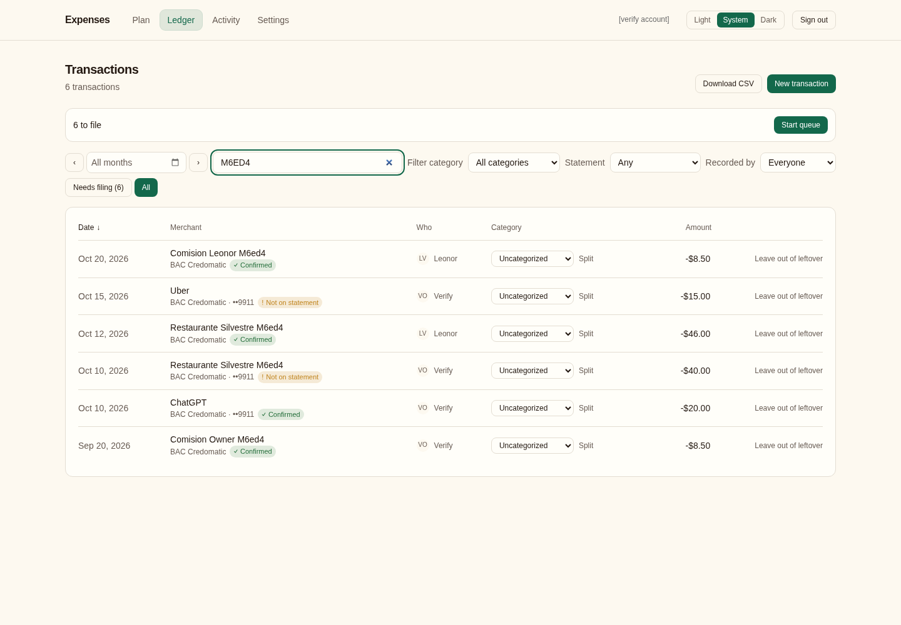
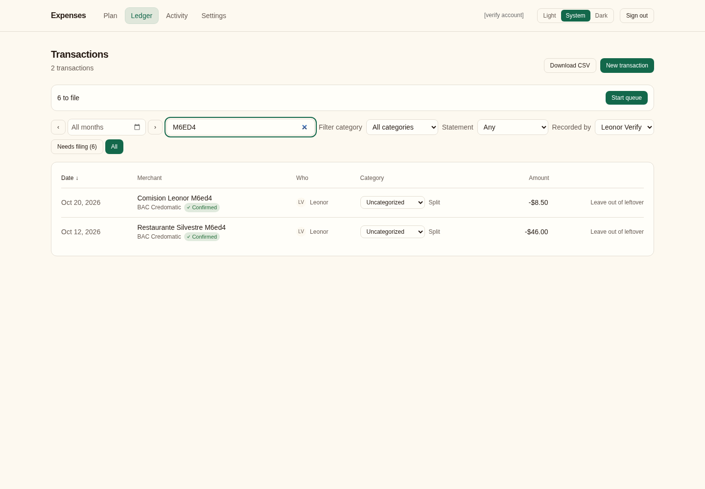
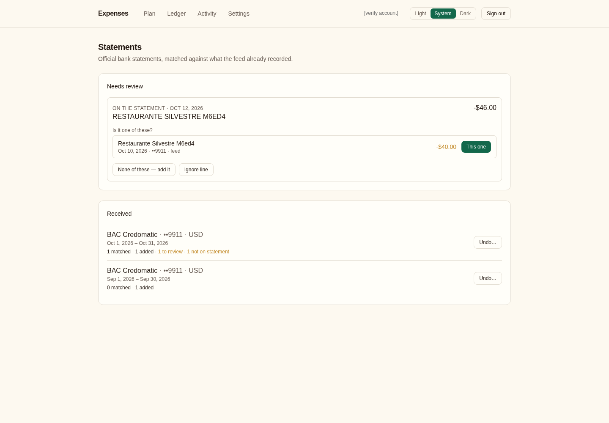
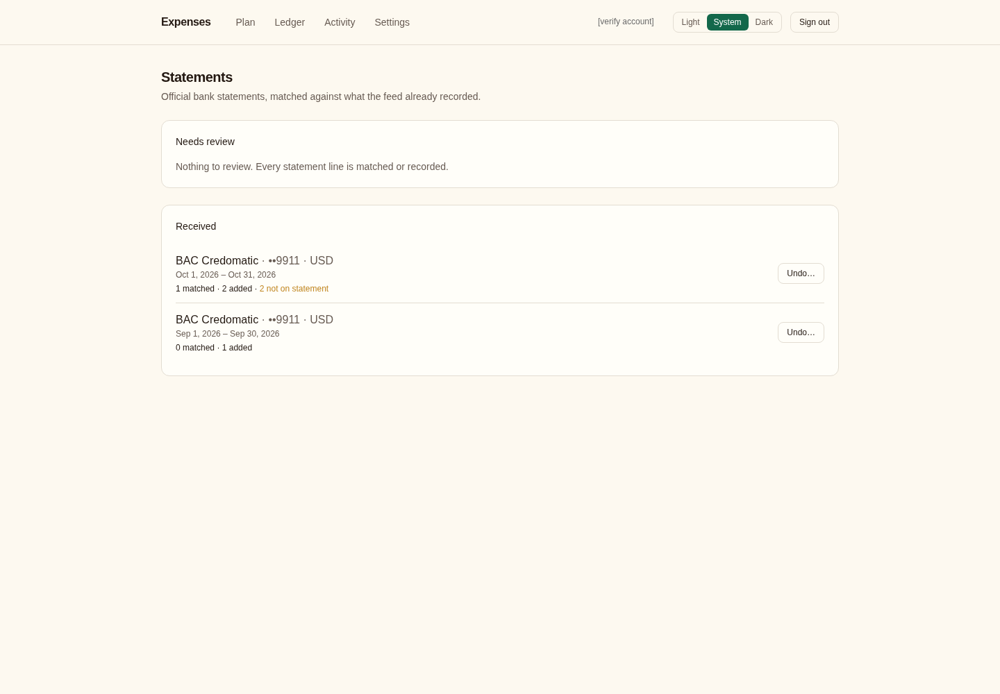

# Expenses issue #75: Statement endpoint credits every new row to the key's member

Fixed by [fabimc/expenses#76](https://github.com/fabimc/expenses/pull/76) (verified at `0f4425f`).

## Setup

- The PR branch ran with `npm run dev` from a separate worktree, against the repo's local Docker Postgres and Neon HTTP proxy (`npm run db:local:up`), migrated and seeded fresh. Nothing touched a shared database.
- The owner signed in through the UI with a generated local account. A second member, **Leonor Verify**, registered and joined through the real invite API (`POST /api/household/invites`, then `POST /api/household/invites/accept`). The Ledger's `Who` column only appears once a household has two members.
- The owner minted one shared feed key, so the key's default "Who" is the owner. Three feed rows were sent on card `9911` in October, then the statements below.
- Driven in headless Chromium with [`harness/verify-pr76.mjs`](harness/verify-pr76.mjs). The account email in the page header is masked as `[verify account]` in the screenshots.

## Results

| Acceptance criterion | Result |
| --- | --- |
| `mailboxEmail` of a member credits the created rows to that member | Leonor's statement (sent as `Leonor@Example…`, so case is ignored) created the `-8.50` fee with `recordedBy` = Leonor. Counts were `{lines: 3, matched: 1, created: 1, needsReview: 1, missing: 1}`. The matched feed row kept the owner as its recorder. |
| A non-member `mailboxEmail` gets 400 and the ledger is untouched | `400` with `mailboxEmail "stranger@example.test" is not a member of this household`. No statement row was written, and every feed row stayed `unreconciled`. See [`stranger-statement.json`](after-pr-76/stranger-statement.json). |
| Without `mailboxEmail`, rows go to the key's member | The September statement with no `mailboxEmail` created its fee credited to the owner. |
| Review-queue **create** credits the statement's person | The owner clicked **None of these — add it** on Leonor's `-46.00` line. The new row is credited to Leonor, not to the owner who clicked. |

### Ledger: `Who` per row

The fees from Leonor's statement and the review-queue row read **Leonor**. The fallback fee and the feed rows read **Verify** (the owner).

### Ledger: `Recorded by` = Leonor Verify

Only her two statement-created rows remain.

### Statements review, before and after the owner adds the line

## Files

- [`after-pr-76/proof.txt`](after-pr-76/proof.txt): every check with timestamps (27 passed, 0 failed) and what changed.
- `*.aria.txt`: accessibility snapshots of each screen, with emails redacted.
- [`plan.png`](after-pr-76/plan.png): baseline Plan proof after sign-in.
