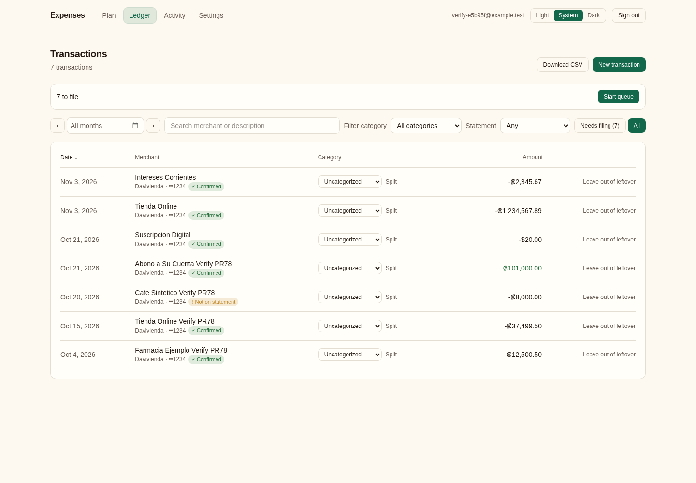
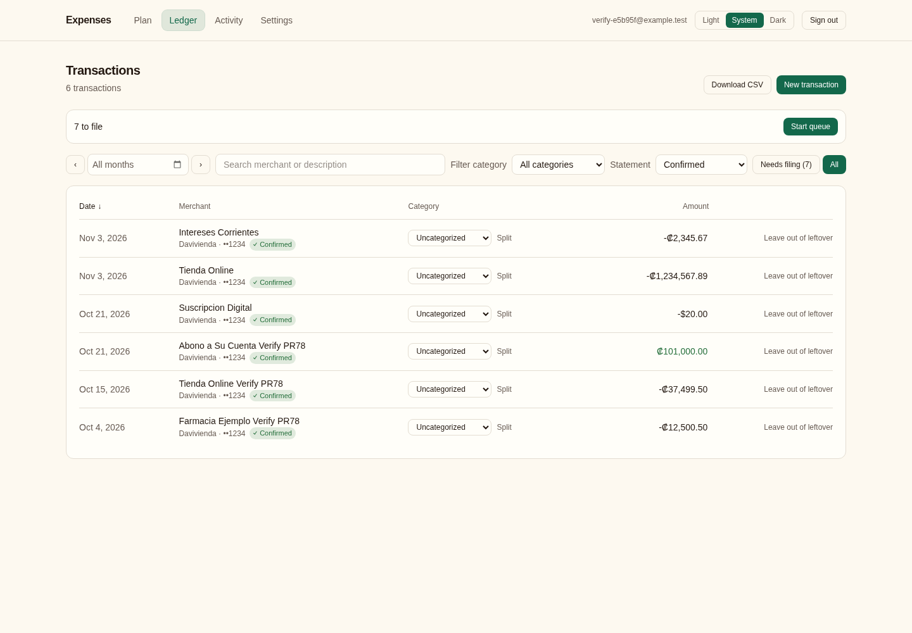
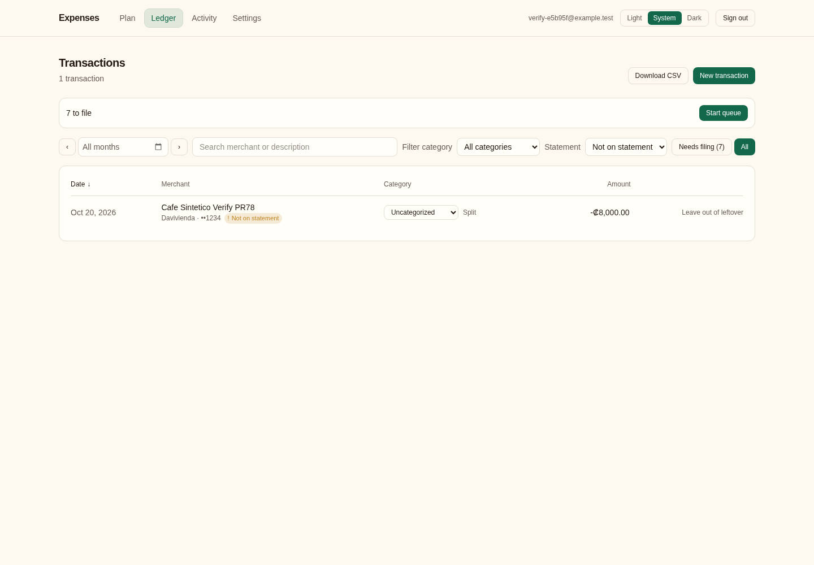
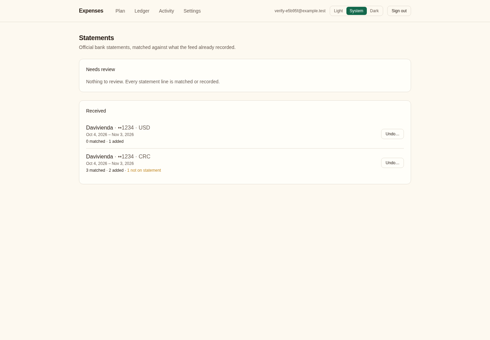
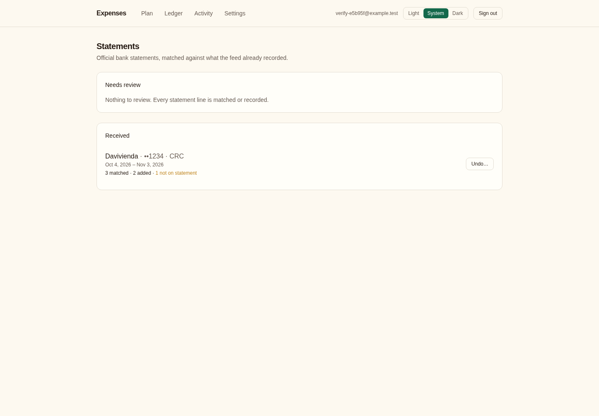
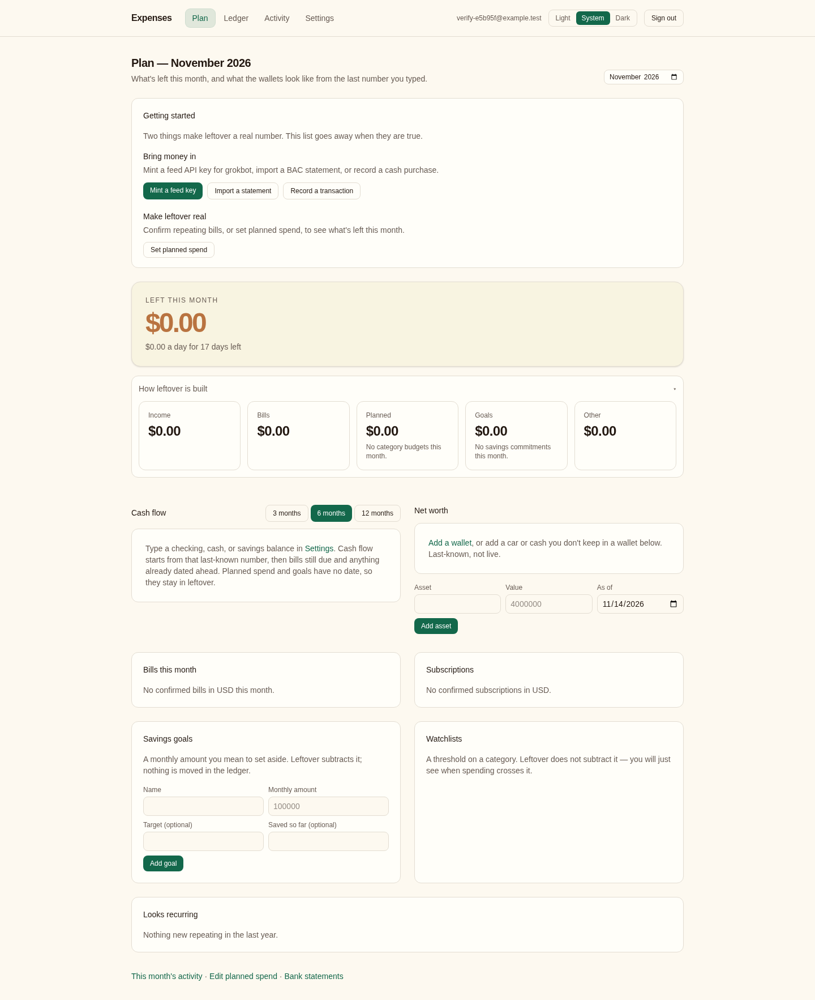

# fabimc/expenses PR #78 / issue #77: Banco Davivienda (Costa Rica), `davivienda-cr`

Live verification of [PR #78](https://github.com/fabimc/expenses/pull/78) at commit `e6e4d6c` (the Bugbot fixes), run on 2026-11-14 against a disposable local Docker database. **Every value here is synthetic.** The statement is the made-up fixture from `src/domain/banks/statements/davivienda-cr_test.ts`, the card is `1234`, and the login is a generated `@example.test` account. The feed key was held in memory only and revoked at the end.

## What was driven

1. `npm run db:migrate` and `npm run db:seed`. `banks` lists `bac-cr`, `davibank-cr` and `davivienda-cr | Davivienda | CR | CRC` ([logs/seed-banks.txt](logs/seed-banks.txt)).
2. Four `davivienda-cr` CRC feed rows on card `1234` via `POST /api/feed/v1/transactions`: `-12 500,50` (10-04), `-37 499,50` (10-15), a `+101 000,00` payment (10-21), and an unlisted `-8 000,00` (10-20) ([logs/feed-transactions.json](logs/feed-transactions.json)).
3. The fixture text was run through `parseDaviviendaStatement`, giving a CRC statement and a USD statement ([logs/statements-parsed.json](logs/statements-parsed.json)). Both were posted to `POST /api/feed/v1/statements`.
   - CRC: `{lines: 5, matched: 3, created: 2, needsReview: 0, missing: 1}` ([logs/statement-crc.json](logs/statement-crc.json)).
   - USD: `{lines: 1, matched: 0, created: 1, needsReview: 0, missing: 0}` ([logs/statement-usd.json](logs/statement-usd.json)).
   - Resending USD returns `alreadyReceived: true`, and an unknown slug gets `400 No seeded bank with slug …`.
4. Ledger and Statements were checked in the browser. The USD statement was then undone, and its created row disappeared.

## Ledger: confirmed rows, created rows and the interest fee

- **Matched and confirmed:** the three matched feed rows (Farmacia Ejemplo, Tienda Online, Abono a Su Cuenta, the green `₡101,000.00` payment).
- **Created and confirmed:** the promotion purchase `-₡1,234,567.89`, the USD `-$20.00`, and the interest fee *Intereses Corrientes* `-₡2,345.67`.
- **Not on statement:** the unlisted café row.

`Statement = Confirmed` shows the six confirmed rows:

`Statement = Not on statement` shows only the unlisted row:

## Statements page

After undoing the USD statement:

Plan baseline:

## Notes

- Every PASS/FAIL line is in [logs/proof.txt](logs/proof.txt). Three FAILs in the first pass were driver locator bugs, not app bugs, and the recheck on the same instance passes:
  - The reconciliation badge's text includes a hidden `✓`/`!` glyph, so an exact text match can't find it; the recheck matches on the badge title.
  - The Accounts `Bank` options were read before they loaded; the recheck waits and finds `None, BAC Credomatic, DAVIbank, Davivienda`.
- The instance ran isolated on its own ports (API `:8001`, Vite `:5174`, Postgres `:55433`, proxy `:4445`), because an unrelated older run held the default ones. [harness/](harness/) has the driver, the parser script, and the compose and Vite overrides used.
- Settings screenshots aren't included: they show the (revoked) feed key prefix.
