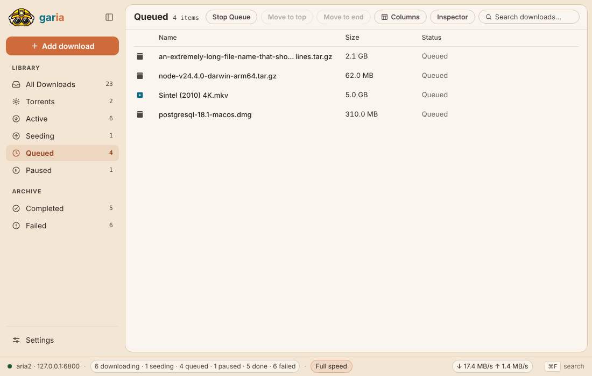
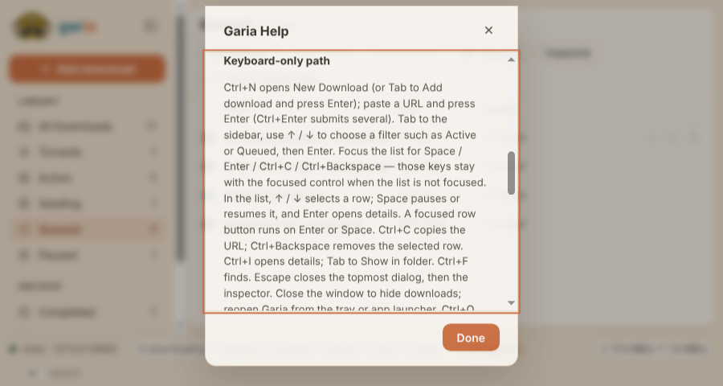

# Issue #121 / PR #176 — keyboard-first Linux journey

Browser-dev (mock aria2, `?platform=linux`) run of PR #176 after merging master
(commit 45c1f7a). Script: [`journey.mjs`](journey.mjs), run against a
`verify-garia` `control-garia launch` instance.

## Delete a queued row by keyboard

Queued filter → focus first row → ↓ → Ctrl+Delete → confirm opens with Cancel
focused → Tab → Enter. RPC: `aria2.remove` then `aria2.removeDownloadResult`
for `bbbb1111`; the row leaves the list and `#notice-banner` stays hidden.

## Help sheet scrolls to the Keyboard-only path

900×480 in-app sheet: `.help-body` is `overflow: auto` (scrollHeight 1703,
clientHeight 321); the Keyboard-only path is reachable, uses Linux `Ctrl+`
labels (no ⌘), and the Done footer stays on screen.

## Also checked

- `npm test`: 84 pass, 0 fail.
- `node --test helpers/keyboard-activation.test.mjs` (Enter/Space on every row control): pass.
- Mock `aria2.removeDownloadResult` now answers like aria2: unknown gid → `GID <gid> is not found`; known, not-yet-stopped gid → `Could not remove download result of GID#<gid>`.
