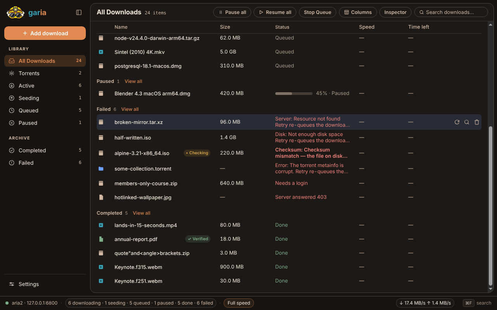
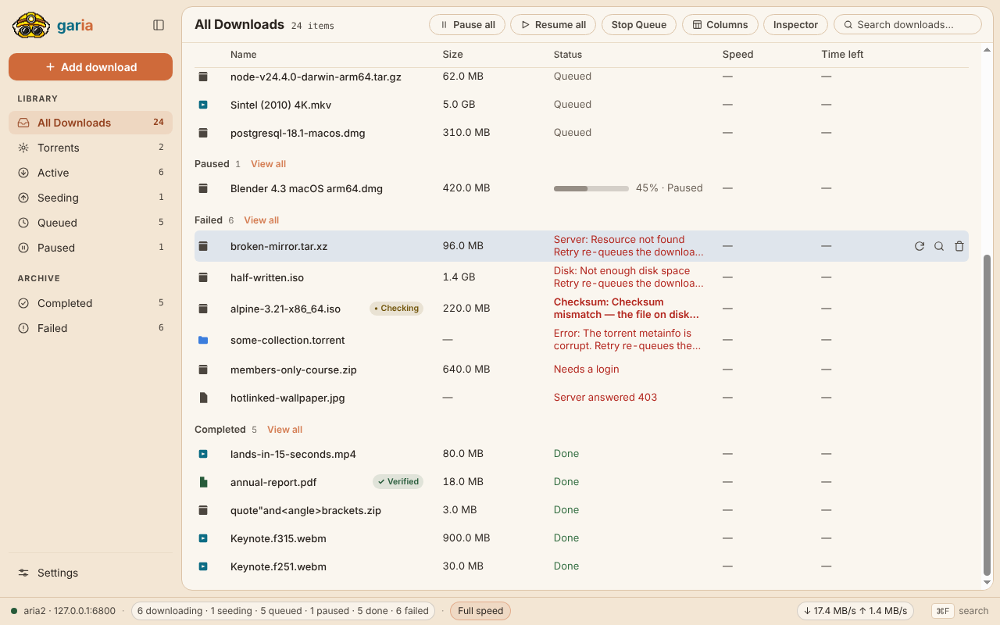

# Issue #123 / PR #177: state text contrast on selected rows

Browser-dev run of [PR #177](https://github.com/fabimc/garia/pull/177) at commit
`91e029d` (the PR branch with master merged in). It uses the mock aria2 and a
`verify-garia` `control-garia launch` instance, and `doctor` reported `ok`
before every drive. Script: [`measure.mjs`](measure.mjs). Raw data:
[`contrast.json`](contrast.json).

Steps, for each `prefers-color-scheme` (emulated as light, then dark) and each
row status: click the first row's status cell to select it, then read the
computed text colour and the row background, once while hovering
(`.is-selected:hover`, an 18% tint) and once without hovering
(`.is-selected`, a 14% tint). The contrast is the WCAG ratio of those two
rendered colours. The stylesheet's goal is at least 4.5:1.

| Scheme | Status | Status text | Text color | Selected | Hover-selected |
| --- | --- | --- | --- | --- | --- |
| light | `active` | 49% | `rgb(37, 90, 168)` | 5.34:1 | 5.09:1 |
| light | `waiting` | Queued | `rgb(105, 95, 85)` | 4.92:1 | 4.69:1 |
| light | `paused` | 45% · Paused | `rgb(105, 95, 85)` | 4.92:1 | 4.69:1 |
| light | `complete` | Done | `rgb(50, 109, 64)` | 4.88:1 | 4.65:1 |
| light | `error` | Server: Resource not found Ret | `rgb(179, 38, 30)` | 5.16:1 | 4.92:1 |
| dark | `active` | 54% | `rgb(109, 159, 255)` | 5.37:1 | 4.98:1 |
| dark | `waiting` | Queued | `rgb(170, 155, 137)` | 5.18:1 | 4.8:1 |
| dark | `paused` | 45% · Paused | `rgb(170, 155, 137)` | 5.18:1 | 4.8:1 |
| dark | `complete` | Done | `rgb(125, 174, 136)` | 5.53:1 | 5.12:1 |
| dark | `error` | Server: Resource not found Ret | `rgb(239, 129, 120)` | 5.39:1 | 5:1 |

Every status clears 4.5:1 in both schemes, both selected and hover-selected.
The lowest ratio is 4.65:1, for light "Done" while hover-selected. The
[real-Omarchy report on #123](https://github.com/fabimc/garia/issues/123#issuecomment-6835120939)
measured these ratios before the fix:

- light Done: 3.89:1
- dark Queued/Paused: 4.27:1
- dark Failed: 4.27:1

A failed row's status text is drawn in `--state-failed`
(`rgb(239, 129, 120)` in dark mode), not `--danger`. The
`.dl-status-text.is-error` colour rule never applies, because the
`.dl-item[data-status=error]` rule is more specific.

## Dark, failed row selected

## Light, failed row selected

Per-row crops: `{light,dark}-{active,waiting,paused,complete,error}-selected.png`.

Not covered here: the live WebKitGTK light/dark switch. The owner confirmed it
on a real Omarchy session in the #123 comment linked above. This run uses
Chromium and an emulated colour scheme.
