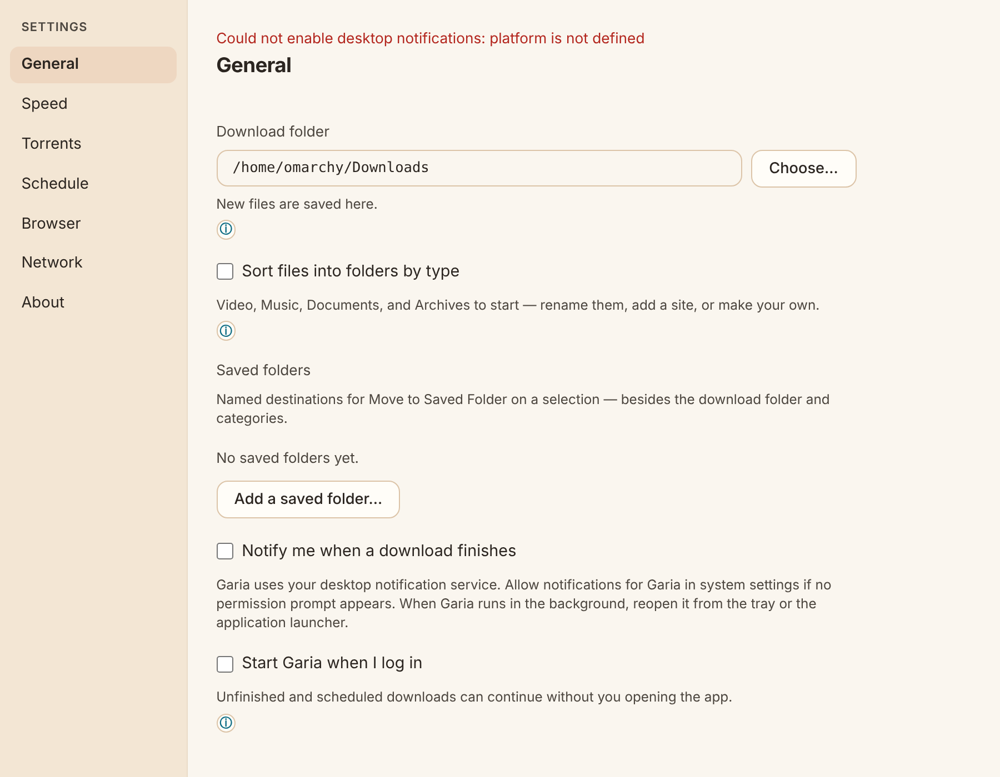
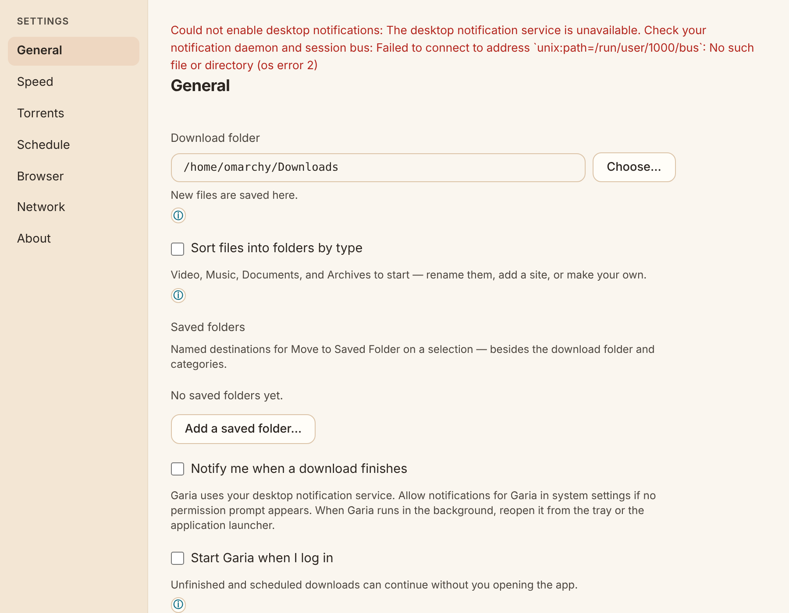
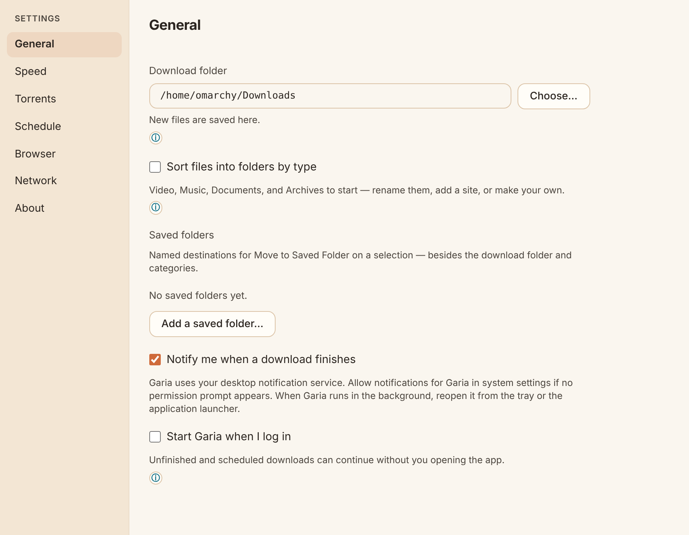

# Issue #125: Linux notifications look enabled with no notification daemon

Fixed by [fabimc/garia#179](https://github.com/fabimc/garia/pull/179), with `master` at `677fc52` merged in plus review fixes (`b34c49f`). Map corrections from the verify-garia maintain pass are in `17b304d`.

## What changed in review

- Master had already landed its own Linux autostart (`autostart_linux.rs`, from #171) and dropped macOS. The PR's `linux_autostart.rs` duplicated it and conflicted, so the merge keeps master's autostart. Only the notification-daemon check from this PR remains.
- **Regression found:** `settings.js` merged without conflicts but still read a `platform` variable that master had removed. Enabling notifications always failed with *platform is not defined*, even when a daemon was running ([before-fix](before-fix/)). Garia is Linux-only now, so the check runs unconditionally.
- The unit test no longer injects `platform` into its sandbox. It now fails on the unfixed code (85 pass / 1 fail) and passes on the fix (85/85).

## Results: the notification-daemon probe (real `notify_rust::get_server_information`, 4.18.2)

[`after-fix/daemon-probe.log`](after-fix/daemon-probe.log), from [`harness/probe-main.rs`](harness/probe-main.rs):

| Scenario | Result |
| --- | --- |
| No session bus | Error: *Failed to connect to address …/bus* |
| Session bus, daemon activation crashes (dunst, no display) | Error: *Process org.freedesktop.Notifications received signal 5* |
| Session bus + running dunst (Xvfb) | `OK server=dunst vendor=knopwob version=1.9.2` |

## Results: Settings (real `settings.html` in Chromium, stubbed Tauri bridge)

[`harness/settings-proof.mjs`](harness/settings-proof.mjs) stubs `window.__TAURI__` with `isPermissionGranted() → true`, as the plugin reports on Linux. `check_notification_service` rejects with the probe's real error until the daemon is "started". It then ticks *Notify me when a download finishes*.

| Step | Before fix (auto-merge) | After fix |
| --- | --- | --- |
| Enable, no daemon | Unchecked, *platform is not defined*, probe never called | Unchecked, *…notification service is unavailable…*, nothing saved |
| Enable, daemon running | Unchecked, *platform is not defined*, nothing saved | **Checked**, no error, saved once |

JSON: [`before-fix/settings-proof.json`](before-fix/settings-proof.json), [`after-fix/settings-proof.json`](after-fix/settings-proof.json).

Not verified natively: a real Tauri window clicking the toggle against a live daemon. The container has no compositor. The probe and the Settings flow above are each tested separately.

## Results: tests (after)

- [`after-fix/rust-tests.log`](after-fix/rust-tests.log): all 133 lib tests pass.
- [`after-fix/js-tests.log`](after-fix/js-tests.log): `npm test`, 85/85 pass.

## verify-garia maintain pass

All 8 mapped features were driven live in browser-dev: browse, filter, detail, pause/resume, add, large list (525 rows), keyboard journey, and first-run. Captures are in [`maintain-verify-garia/`](maintain-verify-garia/). **Outcome: changed.** These map corrections are in `17b304d`:

- **first-run-omarchy:** the `?platform=linux` / `?platform=macos` switch and the `.setup-generic` / `.setup-linux-only` classes no longer exist, so the old recipe's eval would throw. In browser-dev the Help sheet (1810 px in a 657 px viewport) doesn't scroll without the native `in-app` class, so clicking `#help-setup` timed out. The recipe now adds `in-app` first. It was re-driven as written and shows 4 rows plus both links ([screenshot](maintain-verify-garia/first-run-omarchy/checklist-maintain.png)).
- **keyboard-journey, add-download, download-detail:** removed the ⌘ labels and the no-op `?platform=linux` step.
- No product gaps were found. The formal schedule skill wasn't re-run because this PR doesn't touch schedule/decide code.
