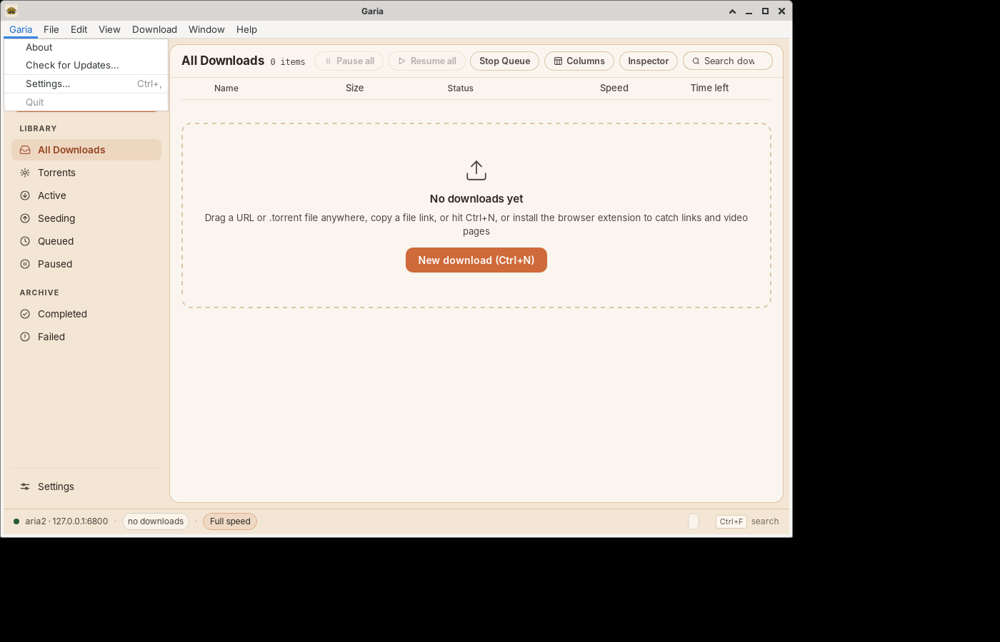
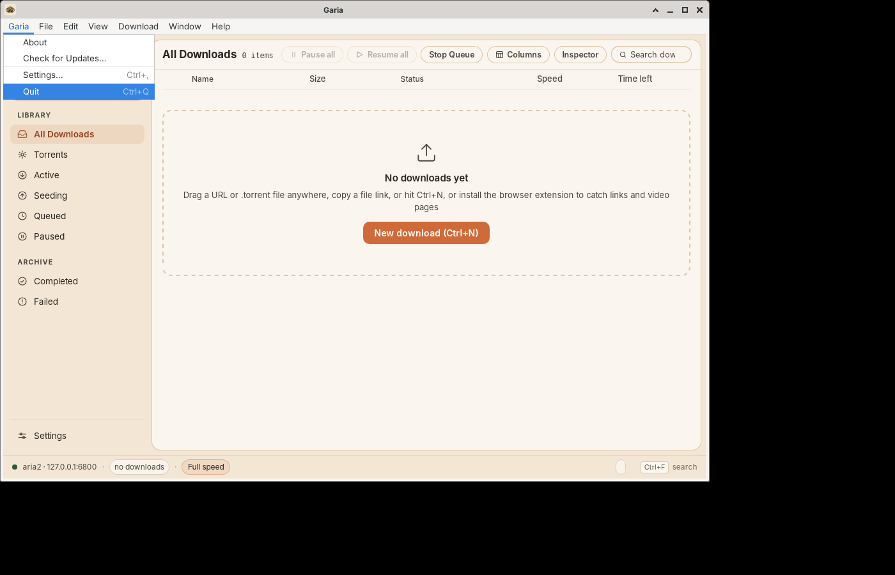

# Issue #192: native menu Quit disabled on Linux

[fabimc/garia#192](https://github.com/fabimc/garia/issues/192)

`garia-menu-quit-disabled.png`: the native **Garia** menu, opened by clicking it, in the desktop app on Omarchy (Hyprland 0.56.2, WebKitGTK 2.54.1). The build is a debug build of `master` at `20c76b1`, run with throwaway XDG folders. About, Check for Updates and Settings are enabled; Quit is greyed out and has no Ctrl+Q accelerator.

## Fix verification

The fix replaces the app menu's predefined `.quit()` (unsupported on GTK in muda) with a custom `MenuItemBuilder::with_id("quit", "Quit").accelerator("CmdOrCtrl+Q")`. It goes through the same `"quit" => app.exit(0)` arm as the tray, and `RunEvent::Exit` stops aria2c.

### Setup

- Two native debug builds (`cargo build` in `src-tauri/`) on Ubuntu 24.04 with WebKitGTK 4.1, run under Xvfb with the xfwm4 window manager inside a private `dbus-run-session`. **Before:** `master` at `a60bc39`. **After:** [PR #194](https://github.com/fabimc/garia/pull/194) at `5c15645`.
- The aria2c sidecar was the system `aria2c` 1.37.0, copied into `src-tauri/binaries/`. That's enough for Quit, which only involves Garia's own aria2c child.
- Each run used a fresh sandbox: `HOME` and the `XDG_*` data, config, cache and state directories pointed at an empty temporary folder.
- [`journey.sh`](journey.sh) launches Garia and clicks **Continue** on the first-run Welcome sheet. It then does one of the following:
  - `menu-click`: clicks **Garia** in the menu bar, hovers **Quit**, then clicks it.
  - `ctrl-q`: presses Ctrl+Q in the main window.
  - `tray-quit`: finds the tray's `com.canonical.dbusmenu` object on Garia's D-Bus connection and sends `Event <Quit id> clicked`, the same call a tray host makes.

  It then waits up to 5 s and records whether the Garia process and **its own** aria2c child (by PID) are still running.

### Results

| Path | Before (`master`) | After (fix) |
| --- | --- | --- |
| Garia menu | **Quit greyed out, no shortcut** ([screenshot](before/menu-click-03-quit-hovered.png)) | **Quit enabled, shows Ctrl+Q** ([screenshot](after/menu-click-03-quit-hovered.png)) |
| Click Quit | Nothing happens. **Garia and aria2c keep running** ([log](before/menu-click.log), [screenshot](before/menu-click-04-still-running.png)) | Garia exits within 1 s. **aria2c is gone**, and none is left on the machine ([log](after/menu-click.log)) |
| Ctrl+Q | Nothing happens. **Garia and aria2c keep running** ([log](before/ctrl-q.log), [screenshot](before/ctrl-q-04-still-running.png)) | Garia exits within 1 s. **aria2c is gone** ([log](after/ctrl-q.log)) |
| Tray → Quit | Exits, and aria2c is gone ([log](before/tray-quit.log)) | **Still works.** Exits, and aria2c is gone ([log](after/tray-quit.log)). The tray items are unchanged ([labels](after/tray-quit.menu-labels.txt)). |

| Before: Quit greyed out | After: Quit enabled with Ctrl+Q |
| --- | --- |
|  |  |

Each folder also has `*.garia.log` (Garia's stderr). The tray runs add `tray-quit.menu-layout.json` (the raw `GetLayout` reply).

### Other checks

- `npm test`: 92/92 pass. The new test, `app menu Quit is a custom Ctrl+Q item on the shared quit path`, fails on `master` and passes with the fix.
- `cargo test` in `src-tauri/`: 136/136 pass.
- The verify-garia skill now maps this journey in `features/native-quit.md` and `helpers/native-quit` in the garia repo.

Not covered here:

- Wayland (Hyprland/Omarchy) with a real tray host.
- macOS. Cmd+Q now goes through `app.exit(0)` instead of the system terminate item, and the same `RunEvent::Exit` cleanup runs.
