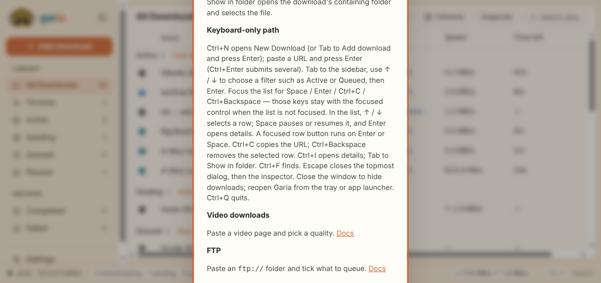
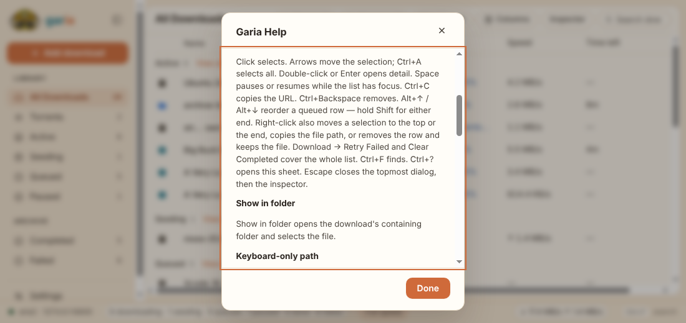

# PR #175: Help sheet keyboard-scrollable in browser-dev

Verifies [fabimc/garia#175](https://github.com/fabimc/garia/pull/175) (for [#120](https://github.com/fabimc/garia/issues/120)) after its review fixes. [#188](https://github.com/fabimc/garia/pull/188) ([evidence](../issue-152-help-scroll/)) already bounded the **in-app** sheet. This PR bounds the **browser-dev** sheet too, and puts the Help scroll rules in one place.

## Setup

- verify-garia browser-dev harness: the mock aria2 RPC and Playwright Chromium at 1100×520, with `?platform=linux`.
- Each run covers two modes: plain browser-dev, and `in-app` (that class added to `<html>`, as the Tauri webview does).
- **Before:** `src/` from `master` at `677fc52`. **After:** the PR head at `525c52f`.
- [`journey.mjs`](journey.mjs) opens Help with Ctrl+Shift+/, presses Page Down until "Keyboard-only path" is inside the Help body, then presses End.

## Results

| Mode | Before (`master`) | After (PR #175) |
| --- | --- | --- |
| Browser-dev | No max-height. The sheet is 1165 px tall in a 520 px viewport, so the header and **Done** are both off-screen. End scrolls nothing. | max-height 480 px, and the sheet ends at y=500. Focus lands on the Help body, one Page Down reaches "Keyboard-only path", End scrolls 1350 px, and **Done** stays visible throughout. |
| In-app | max-height 488 px (`100vh - 32px`). Scrolls. **Done** is visible. | Unchanged: 488 px, End scrolls 1342 px, **Done** is visible. The PR's original `100vh - 58px` override was removed in review. |

Measurements per mode and step are in each folder's `help-scroll.json`. `npm test`: 85/85 pass.
